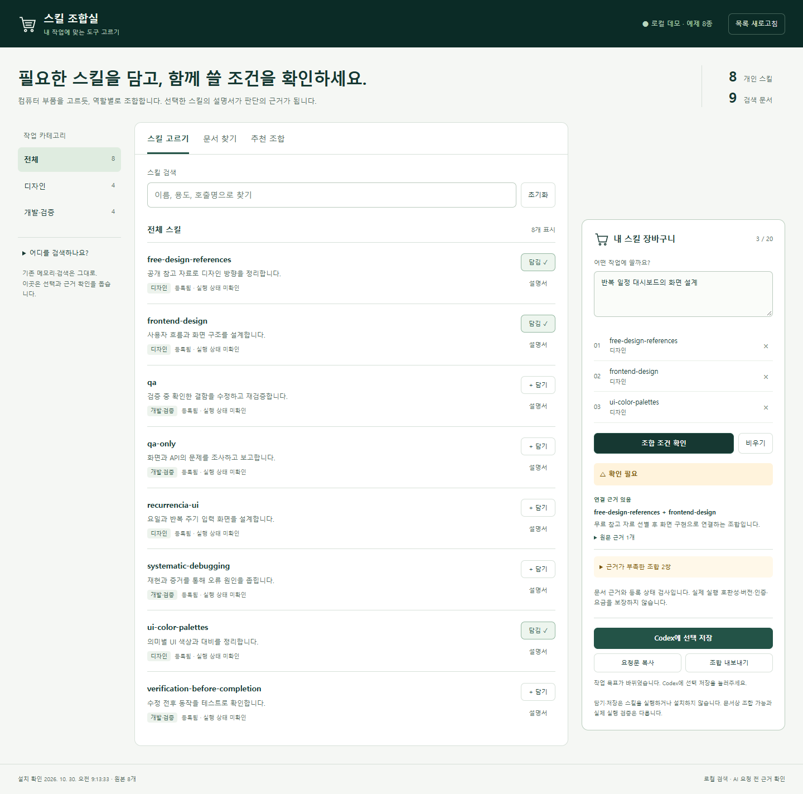
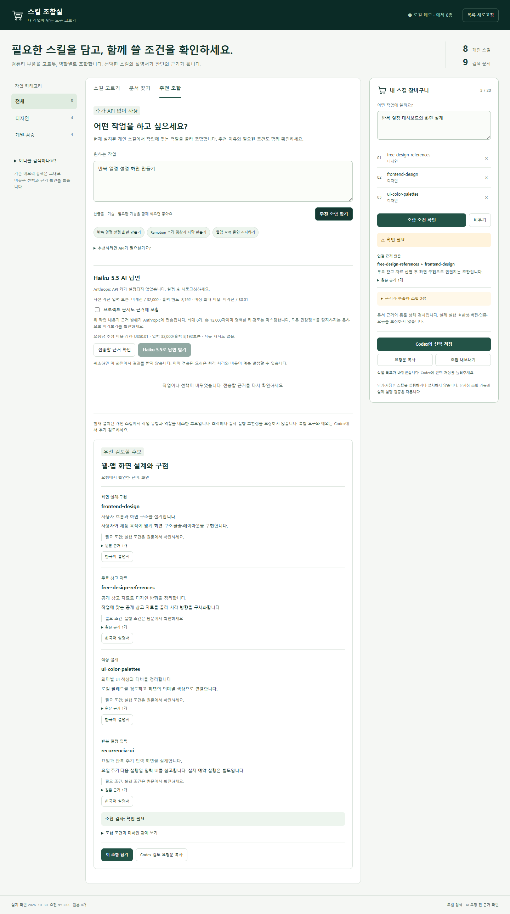

# Mixing Skills · 스킬 조합실

[](https://github.com/castle923/Mixing-skills/actions/workflows/test.yml)

**설치한 AI 스킬을 작업별로 고르고, 함께 쓸 조건을 원문 근거로 확인하는 로컬 워크벤치입니다.**

스킬이 많아지면 이름만으로는 용도와 필요한 도구를 파악하기 어렵습니다. 여러 스킬을 선택해도 실제로 연결되는지, 실행 조건이 무엇인지 알기 어렵습니다. Mixing Skills는 카탈로그·문서 검색·추천을 한 화면에 모으고, 추천 이유에서 설명서의 경로와 줄 번호로 돌아갈 수 있게 합니다.



## 무엇을 할 수 있나요?

| 화면 | 하는 일 |
| --- | --- |
| 스킬 고르기 | 이름·용도·호출명과 카테고리로 탐색하고 최대 20개를 장바구니에 담습니다. |
| 문서 찾기 | 스킬 설명서와 지정한 프로젝트 문서에서 관련 문단·출처·줄 번호를 찾습니다. |
| 추천 조합 | 작업 유형에 맞는 역할별 후보와 조건을 보여줍니다. 기본 추천에는 API가 필요하지 않습니다. |
| 장바구니 | 문서에 근거한 조합 조건과 미확인 관계를 확인하고, 선택을 저장하거나 Markdown 요청문으로 내보냅니다. |

선택 저장은 로컬 파일 저장입니다. 스킬 설치·실행, Codex 설정 변경, 새 에이전트 실행을 승인하거나 수행하지 않습니다. **등록됨은 실행 준비 완료를 뜻하지 않으며, 근거가 없는 조합은 미확인으로 남깁니다.**

<details>
<summary>모바일 화면</summary>


</details>

## 빠르게 실행하기

Python 3.11 이상과 SQLite FTS5의 `trigram` 토크나이저가 필요합니다. 기본 UI·CLI는 Python 표준 라이브러리만 사용합니다. 저장소를 내려받은 뒤 해당 폴더에서 실행합니다.

```powershell
git clone https://github.com/castle923/Mixing-skills.git
cd Mixing-skills
python -m venv .venv
.\.venv\Scripts\python.exe -X utf8 workbench.py serve
```

Windows에서는 `./launch.ps1`도 사용할 수 있습니다. 로컬 가상환경의 Python을 우선하고, 없으면 PATH의 `python`을 사용합니다. 해당 Python이 3.11 이상이어야 합니다. 브라우저에서 시작 로그에 나온 `http://127.0.0.1:<port>`를 엽니다. 서버는 `127.0.0.1`에만 바인딩합니다.

공개 패키지는 직접 작성한 예제 스킬과 프로젝트 문서로 시작합니다. 개인 설치 경로·실제 개인 설명서·기존 번역 자료를 포함하지 않습니다.

```json
{
  "skill_roots": ["examples/skills"],
  "project_roots": ["examples/project"]
}
```

위 항목은 `settings.json`의 검색 범위입니다. 개인 환경에 연결하려면 원하는 로컬 폴더로 바꾸고 목록을 새로고침하세요. 스킬은 설정한 루트의 `SKILL.md`를 스캔하며, Codex 설치나 전역 인벤토리 스크립트에 의존하지 않습니다. 프로젝트 문서는 Markdown·TXT·RST만 대상으로 하며 PDF·Office 파일은 먼저 변환해야 합니다.

CLI로도 같은 검색·검사 로직을 사용합니다.

```powershell
.\.venv\Scripts\python.exe -X utf8 workbench.py search "디자인" --kind skill
.\.venv\Scripts\python.exe -X utf8 workbench.py refresh
```

## 선택 기능: AI 답변

기본 추천은 로컬 규칙과 검색만 사용합니다. 복잡한 작업 설명을 해석할 때는 서버 프로세스의 `ANTHROPIC_API_KEY` 환경변수로 Anthropic 답변을 선택할 수 있습니다. 키는 브라우저에 전달하지 않으며 `.env`를 자동으로 읽지 않습니다. 모델 접근 권한과 공급자 비용은 별도입니다.

사용자가 **전송할 근거 확인 → 답변 받기**를 누르면 작업 설명·후보 ID·마스킹한 근거 발췌가 전송됩니다. 프로젝트 문서는 별도 선택 항목입니다. 경로는 로컬 화면에만 표시하지만 발췌 내용은 직접 검토해야 합니다.

| 제한 | 구현 값 |
| --- | --- |
| 후보 / 근거 | 최대 12개 / 8개, 근거 합계 12,000자 |
| 입력 / 출력 | 최대 32,000 / 8,192토큰 |
| 비용 검사 | 생성 전 토큰 계산과 코드 내 단가로 추정 최대 US$0.01 검사 |
| 처리 | 전체 45초 제한, 동시 1건, 생성 1회, 자동 재시도 0회 |

비용은 앱의 **추정치**이며 공급자의 실제 청구 상한을 설정하지 않습니다. 단가·모델 ID·API 버전은 `ai_service.py`의 설정값입니다. 응답의 스킬 ID와 근거 ID를 서버에서 검증하고, 호환성은 로컬 검사로 다시 계산합니다. 취소 후에도 이미 시작된 원격 처리·과금은 계속될 수 있습니다.

## 선택 기능: Codex MCP 연결

```powershell
.\.venv\Scripts\python.exe -m pip install -e '.[mcp]'
.\.venv\Scripts\python.exe skills_mcp.py
```

`skills_mcp.py`는 검색·문서 읽기·카탈로그·조합 검사·저장한 장바구니 조회·로컬 추천을 제공하는 stdio 서버입니다. 아래는 Codex 설정에 **직접 경로를 맞춰 추가하는 예시**입니다. 앱은 전역 설정을 자동 변경하지 않습니다.

```toml
[mcp_servers.skill_workbench]
command = 'C:\path\to\Mixing-skills\.venv\Scripts\python.exe'
args = ['C:\path\to\Mixing-skills\skills_mcp.py']
```

MCP 연결은 선택 사항이며 UI 실행에는 필요하지 않습니다. 검색 결과는 근거 자료로만 취급하고 선택한 `SKILL.md`와 실제 도구의 준비 상태를 확인해야 합니다.

## 검증과 구현 범위

```powershell
.\.venv\Scripts\python.exe -m unittest discover -v
```

UI 개발·스모크 테스트에는 Node.js 20 이상이 추가로 필요합니다.

```powershell
npm install
npx playwright install chromium
npm run test:ui
```

UI 테스트는 `smoke_demo_ui.cjs`, `smoke_ai_ui.cjs`로 데모 탐색과 AI 흐름을 확인합니다. AI 테스트는 모의 응답을 사용하며 실제 API 연결을 증명하지 않습니다. Windows 로컬 Chrome과 Ubuntu CI Chromium에서 데모 서버·화면을 검증했습니다. macOS는 미검증입니다.

공개 패키지에서 **Python 테스트 40개와 Chrome의 데모·AI 모의 UI 테스트를 통과**했습니다. 데모 화면은 API 키를 제거한 별도 프로세스에서 촬영했으며 실제 사용자 자료를 포함하지 않습니다. [상세 검증 기록](docs/testing.md)을 확인하세요. GitHub Actions에는 Python 3.11/3.13 × Windows/Linux 및 Chromium 검사를 구성했으며 최초 공개 커밋의 원격 검사 5개가 모두 통과했습니다. [검증 실행 기록](https://github.com/castle923/Mixing-skills/actions/runs/40978055363)에서 결과를 확인할 수 있습니다.



- [설계와 데이터 흐름](docs/architecture.md): SQLite FTS5, 근거 연결, 선택적 AI
- [포트폴리오 사례](docs/portfolio.md): 문제 정의, 설계 선택, 검증 범위
- [보안과 개인정보](docs/security.md): 로컬 경계, 외부 전송, 남은 제한

이 프로젝트는 범용 호환성 검증기나 스킬 실행 엔진이 아닙니다. 검색은 임베딩 기반 의미 검색이 아닌 키워드 기반 검색이며, 추천의 품질은 원문과 명시한 규칙의 범위에 달려 있습니다.

## 라이선스

라이선스는 저장소 소유자의 결정 대기 중입니다. 공개 열람을 재사용 허가로 해석하지 마세요. 이 패키지에 MIT 등 별도 오픈소스 라이선스를 자동 적용하지 않았습니다.
