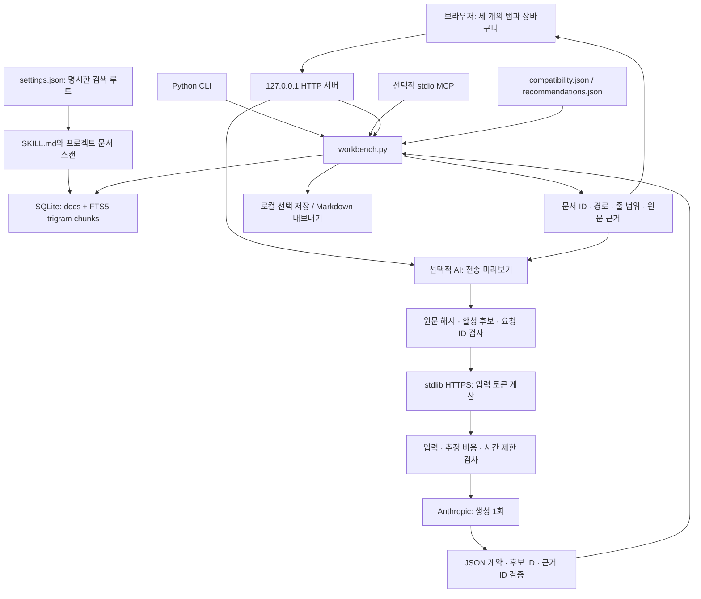

# 설계와 데이터 흐름

Mixing Skills는 문서를 읽고 후보를 고르는 로컬 애플리케이션입니다. UI, CLI, 선택적 MCP가 같은 `workbench.py` 로직을 사용하며, 선택적 AI는 검색된 근거를 설명하는 역할만 맡습니다.

## 로컬 검색: 먼저 찾고, 필요한 부분만 읽기

문서는 40줄 청크를 30줄 간격으로 나누어 색인합니다. 겹치는 10줄은 문단 경계에서 근거가 잘리는 일을 줄입니다. SQLite FTS5 `trigram` 검색과 BM25를 사용하고, 3자 미만 검색어는 이스케이프한 `LIKE` 검색으로 보완합니다. 작은 한·영 키워드 매핑과 단어 포함 수로 재정렬하며 한 문서에서는 최대 두 청크를 반환합니다.

검색 결과에는 문서 ID, 경로와 줄 범위를 붙입니다. UI와 MCP는 **검색으로 ID를 얻고 → 해당 ID로 원문 구간을 읽는 두 단계**를 사용합니다. 읽기 API는 임의 파일 경로를 받지 않습니다. 문서·설정·목록 변경을 확인하는 서명으로 필요할 때 색인을 다시 구성합니다.

이 구조는 검색 근거를 공급하는 RAG의 retrieval 층입니다. 선택적 AI를 켜면 검색한 발췌를 생성 입력에 연결합니다. 기본 로컬 추천은 생성 모델을 호출하지 않습니다. 임베딩, 벡터 DB, 전면적인 의미 검색을 구현한 것은 아닙니다.

## 추천과 조합 검사

`recommendations.json`의 작업 분류가 역할별 스킬 후보를 고르고, `compatibility.json`의 명시적 관계와 요구사항을 설명서에서 확인합니다. 결과는 문서상 연결 근거, 추가 확인 조건, 제한 사항, 근거가 없는 쌍을 구분합니다. 명시한 관계가 없다는 이유로 조합을 승인하지 않습니다.

장바구니는 선택과 목표를 보관하는 제안서입니다. 로컬 저장 또는 요청문 내보내기 이후의 스킬 실행은 앱의 범위 밖입니다. MCP도 같은 읽기·추천 기능을 제공할 뿐 실행 도구를 제공하지 않습니다.

## AI 경계

`ai_service.py`는 Python 표준 라이브러리 `http.client.HTTPSConnection`으로 공급자에 연결합니다. 입력 토큰 계산 후 생성 요청을 한 번 보내며 자동 재시도하지 않습니다. 미리보기는 서버 메모리에 보관하고 10분 후 만료시킵니다. 한 번 사용한 미리보기와 중복 요청 ID는 재사용할 수 없습니다.

미리보기 이후, 전송 전후에 활성 후보와 원문 SHA-256을 다시 확인합니다. 모델은 제시된 후보 ID와 근거 ID만 반환할 수 있습니다. JSON 중복 키·예상 밖 필드·미등록 ID·해당 스킬과 연결되지 않은 근거·불완전 종료 응답을 거부합니다. 최종 조합 판단은 모델 문장 대신 로컬 검사로 다시 계산합니다.

## 왜 LangChain과 벡터 DB를 넣지 않았나요?

현재 목표는 작은 로컬 문서 집합에서 출처를 빠르게 확인하는 것입니다. SQLite는 별도 서버 없이 검색·메타데이터를 함께 저장하고, Python 표준 라이브러리는 UI 서버와 HTTPS 요청을 처리합니다. LangChain은 이 단계의 고정된 두 요청과 검증 흐름을 위해 필수적이지 않습니다. 벡터 검색도 외부 임베딩 비용·모델 다운로드·인덱스 운영 부담을 정당화할 검색 품질 측정이 아직 없습니다.

동의어·문장 수준 검색의 누락이 평가 데이터에서 확인되면 임베딩 도입을 검토할 수 있습니다. 현재의 키워드 검색을 의미 검색으로 표현하지 않는 것이 설계의 일부입니다.

## 공개 데모의 경계

기본 검색 범위는 `examples/skills`, `examples/project`입니다. 예제는 기능 시연용으로 직접 작성한 자료이며 실제 도구의 설치·인증·라이선스·실행 호환성을 증명하지 않습니다. 개인 번역·원문 보관본·실제 사용자 설정은 공개 패키지에 포함하지 않습니다.
